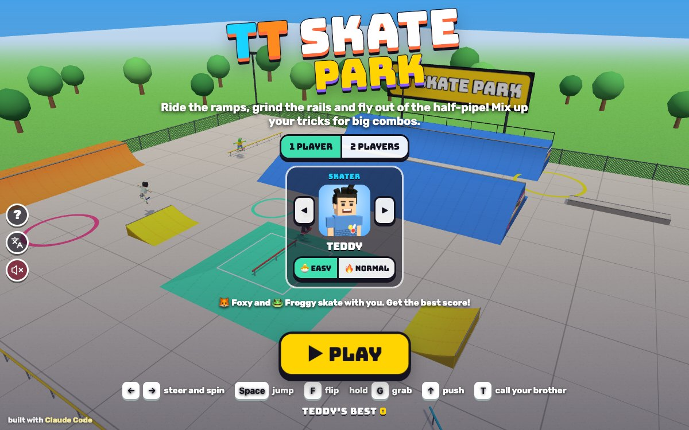

# TT Skate Park

Press **?** any time (or tap the round **?** button on the left edge) to see the keys. The game waits while you look.
Tap the language button under it (the A文 icon) to switch between English and 中文; the dashboard and every game remember the choice.

**中文：** 3D 滑板公园：Teddy 和 Tommy 在坡道、栏杆和 U型池里做跳跃、翻板、抓板和滑杆技巧，连起来就是高分连招；随时叫兄弟来，他会给你指一条技巧路线。

A 3D skate park starring Teddy and Tommy. Ride a half-pipe with a bank to drop in from, two quarter pipes, two kickers, a funbox with a rail on top, long rails and ledges. Ollie, kickflip, grab and spin in the air, lock onto rails to grind, and chain tricks without stopping for combos. A run is 90 seconds: skate against 🦊 Foxy and 🐸 Froggy, or take turns with your brother, and call him over any time to show you the next trick line.
It's built with Claude Code from plain JavaScript and Three.js, in the same style as Metro Surfer and the other Teddy & Tommy games. There are no image, model or audio files: the park is built from the same shapes the physics rides, the characters come from the shared kit (`kit/`), and every sound is synthesised.

The name lives in one place, [js/title.js](js/title.js).

## Play

- **Double-click `index.html`.** It works offline, because Three.js and the kit are copied into `kit/`. Without internet the logo falls back from the Bungee font to Arial Black.
- **Send one file:** `dist/skate-tt.html` is the whole game in one file. AirDrop or email it, then open it in a browser.
- **Rebuild that file** after any edit: `python3 kit/tools/bundle.py . --name skate-tt`
- **Get kit updates** from `~/claude-games/kit`: `python3 ../kit/tools/sync.py .`, then rebuild.
- **On the title screen** pick 1 PLAYER or 2 PLAYERS, then the skater with ◀ ▶ (Teddy, Tommy and the rest of the kit's cast) and 🐣 EASY or 🔥 NORMAL for each. Then ▶ PLAY.
- **Saved per browser:** 1 or 2 players, who, each kid's EASY/NORMAL, and each kid's best score per level. `index.html` and `dist/skate-tt.html` each keep their own, because they're different ways of opening the game.

### 1 player and 2 players

- **1 PLAYER:** a 90-second jam. 🦊 Foxy and 🐸 Froggy skate the park's trick lines at the same time, with their scores in the top right; the best score at the horn wins. Foxy is steady, Froggy wobbles, forgets tricks and sometimes falls. When you're on EASY they take a slow roll between their lines, so Tommy has a real chance.
- **2 PLAYERS:** take turns. The first skater has a 90-second run, then "TOMMY'S TURN!" and the other has his, with the score to beat on screen. The best score wins.
- **The end:** everyone lines up in front of the funbox. The winner does his signature move (Teddy's boxing or his 🏀 jump shot, Tommy's Y with peace fingers) in the middle with confetti and a fanfare, the others wave, and there's the final list, each kid's best (or NEW BEST!), and ↻ PLAY AGAIN.

### EASY and NORMAL

| | 🐣 EASY (Tommy, 5) | 🔥 NORMAL (Teddy, 8) |
|---|---|---|
| speed | rolls along by himself, pumps in the half-pipe, and always makes it to the top of the big ramps | push with ↑ (or PUSH), pump down the transitions to go higher |
| kickers | pops off the lip by himself | ollie at the lip for big air |
| rails and ledges | rides into them and ollies on by himself; a rail pulls him in from a metre away | ollie onto them, lined up; bump into a rail and you bounce off |
| on a rail | no balancing | keep the balance bar in the middle with ← → |
| flips | always finish, however late you start them | a flip that isn't done when you land is a bail |
| landing | always lined up for you | land sideways and you bail |
| air | floatier, and every half-pipe air goes at least as high as the coping | real gravity |
| the brother's line | the board steers itself along it, and ollies at the jump stars | you ride it yourself |
| combo time | 2.6 s after landing to start the next trick | 1.3 s |

A **bail** ("OOPS!") loses the combo you were on, and you're back up in a second and a half. On EASY there are no bails.

## Tricks and scoring

- **In the air:** an OLLIE (Space or JUMP), AIR off a kicker or a quarter pipe's lip, VERT AIR out of the half-pipe (you go straight up and turn round to come back down the same wall). Flips: KICKFLIP (F), HEELFLIP (hold ← and F), POP SHOVE-IT (↓ and F), 360 FLIP (↑ and F); press F again during a flip for another. Grabs, held: INDY (G), MELON (← and G), NOSEGRAB (↑ and G), TAILGRAB (↓ and G), worth more the longer you hold. Spin with ← → in the air: 180, 360, 540, 720, 900.
- **On rails and ledges:** 50-50 when you land along it, BOARDSLIDE when you come in at an angle; points for every second you stay on. Pop off with Space.
- **Combos:** everything you do before you've been rolling for a moment without a new trick is one combo. It scores the sum of its tricks times how many tricks are in it (plain ollies add points but not to the multiplier). The same trick again in one combo is worth half each time, so mixing them up pays. A combo of 12 tricks banks itself at the next landing. NICE!, AWESOME! and SICK COMBO! cheer the big ones. The bar under the skater shows the tricks so far and "points × multiplier", then the points it banked (green) or lost (red).
- **Points:** ollie 50, air 100 (+100 a second), vert air 150 (+150 a second), kickflip and heelflip 300, pop shove-it 250, 360 flip 500, grabs 200 to 250 (+300 a second), 50-50 150 (+200 a second), boardslide 200 (+250 a second), spins 150 / 400 / 800 / 1200 / 2000. The brother's line: ⭐ +100 for each star, +500 for the whole line.

## The park

The park ([js/park.js](js/park.js)) is a height field made of shapes: a 22 m half-pipe with 3.2 m transitions and 2.3 m decks, a bank up to its south deck to drop in from, quarter pipes along the east and west fences, two kickers facing them, a funbox in the middle with a red rail along its top, a long yellow rail, a blue diagonal rail, a rail by the half-pipe, and two ledges with steel edges. Around it: a chain-link fence, bleachers, lamp posts, trees, and a big sign over the half-pipe with the game's name (every TT in the brothers' colours). The half-pipe's ends have our own mural of stars, swooshes and a TT.

## Controls

| Keys | Touch | |
|---|---|---|
| `←` `→` or `A` `D` | ◀ ▶ | steer; spin in the air; balance on a rail (NORMAL) |
| `↑` or `W` | ▲ PUSH (NORMAL) | push, and pump down the transitions |
| `↓` or `S` | | slow down |
| `Space` | JUMP | ollie; pop off a rail |
| `F` (or `J`) | FLIP | flip trick; hold an arrow first for the others |
| hold `G` (or `K`) | hold GRAB | grab |
| `T` | your brother's face | call your brother |
| `P` or `Esc` | ❚❚ | pause |
| `M` | 🔊 | sound on or off |
| `Enter` | | start, next turn, play again |

FLIP and GRAB on the ground do an ollie first. When the brothers take turns they use the same keys.

## Companion

Call your brother any time with `T` or his face button (top right), as often as you like. He pops in rolling along beside you on his own board, at his buddy size, does his signature move (Tommy's Y with peace fingers, Teddy's boxing, or his jump shot with a 🏀) and tosses you a treat (🍦 💧 🧃 🍪 🍉 🍌, "🍦 ICE CREAM FROM TEDDY!"). Then he **shows you the next trick line**: the one nearest ahead of you lights up on the ground with gold arrows, an icon over each trick (⬆️ jump, 🌀 flip, ✋ grab, 🔄 spin, 🛤️ the rail) and a star at each spot, "TEDDY SAYS: GRIND THE BIG DIAGONAL RAIL!", and he skates it just ahead of you. On EASY your board steers itself along it. When the line's done he waves bye and pops out; call him again for the next one. When both brothers are playing (taking turns), the one waiting comes in for a HIGH FIVE! first.

There are eight lines: the funbox rail into the half-pipe, the long rail, each kicker into its quarter pipe, the long ledge, the diagonal rail, the rail by the half-pipe, and out of the half-pipe onto the far ledge.

## How it's tested

- `node tools/check.js` (about 10 s) runs the physics, scoring and autopilot with no browser, on the same files the page uses:
  - **Tricks land reliably on EASY:** the autopilot skates all eight trick lines on EASY and lands each line's tricks with no bail; 300 runs of random button mashing on EASY never bail and finish every one of their 7,700 flips; NORMAL mashing does bail (so it's EASY keeping Tommy up).
  - **Scoring:** a kickflip is 300, kickflip + 1 s 50-50 is 1,300, ollie + kickflip 350, two kickflips 900, a half-second indy 350, a 360 400; a NORMAL bail in the middle of a flip loses the kickflip before it; and in real runs the score is exactly the banked combos.
  - **No falling through ramps:** 480 random rides and 3,000 drops from the sky onto every ramp (falling at up to 12 m/s, with up to 11 m/s sideways) never end up inside anything (deepest: 0 m), never pass up through a ramp's side, and stay in the park; every rail stands above its ground.
- `node tools/check.js --fail` proves the check can fail: it breaks one rule at a time (EASY's help off, no combo multiplier, fast falls through the ground, ramp sides not solid) and each one fails the check (4 of 4 caught).
- `node tools/check.js --lines` shows what each line lands on EASY and NORMAL.
- In the page, `game.check()` runs a quicker version and `game.checkFail()` the sabotages; `game.start()`, `game.step(seconds)`, `game.auto(lineId)` and `game.info()` drive it for tests.
- `node tools/shoot.js tools/play.json` plays a run from `file://` in headless Chrome (muted) and checks for page errors; `tools/shots.json` takes `docs/screenshot.jpg` at 1200 x 750.

## Not verified

- Sound by ear: everything was tested muted, and sound was checked in code (every effect runs without errors, M and 🔊 switch it).
- Real touch devices and how the touch pad feels; real kids' difficulty; speed on an old iPad.
- Phone portrait (390 x 844), phone landscape (740 x 360) and iPad (1024 x 768) were checked in headless Chrome with touch emulation, not on devices.
- Adding the game to an iPad home screen (the icon is 🛹 on coral #ff6b3d).
- Double-clicking from Finder: `index.html` and `dist/skate-tt.html` were tested from `file://` in headless Chrome.
